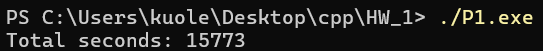
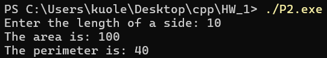
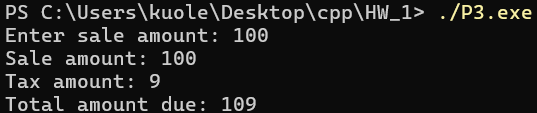
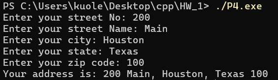

# P1
```cpp
#include <bits/stdc++.h>
using namespace std;

int main() {
    cout << "Total seconds: " << 4*60*60 + 22*60 + 53 << endl;
    return 0;
}
```


# P2
```cpp
#include <bits/stdc++.h>
using namespace std;

int main() {
    cout << "Enter the length of a side: ";
    int len;
    cin >> len;

    cout << "The area is: " << len * len << endl;    
    cout << "The perimeter is: " << len * 4 << endl;    

    return 0;
}
```


# P3
```cpp
#include <iostream>
using namespace std;

int main() {
    const double tax = 0.09;
    
    double sale_amount;
    
    cout << "Enter sale amount: ";
    cin >> sale_amount;
    cout << "Sale amount: " << sale_amount << endl;
    cout << "Tax amount: " << sale_amount * tax << endl;
    cout << "Total amount due: " << sale_amount + sale_amount * tax << endl;

    return 0;
}
```


# P4
```cpp
#include <iostream>
#include <string>
using namespace std;

int main() {
    string street_no, street_name, city, state, zip_code;

    cout << "Enter your street No: ";
    cin >> street_no;
    
    cout << "Enter your street Name: ";
    cin >> street_name;
    
    cout << "Enter your city: ";
    cin >> city;
    
    cout << "Enter your state: ";
    cin >> state;
    
    cout << "Enter your zip code: ";
    cin >> zip_code;

    cout << "Your address is: " << street_no << " " << street_name << ", " << city << ", " << state << " " << zip_code << endl;

    return 0;
}
```
