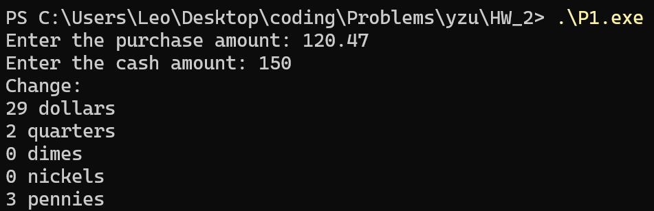
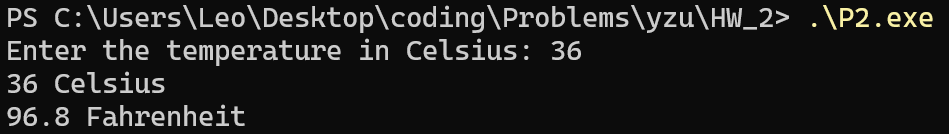
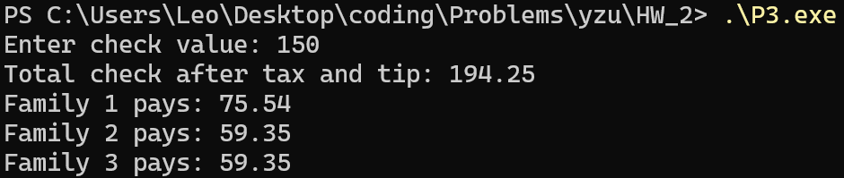
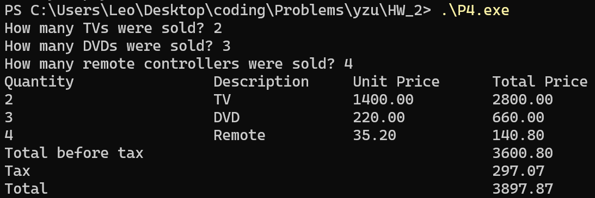

# P1
```cpp
#include <bits/stdc++.h>
using namespace std;

int main() {
    ios_base::sync_with_stdio(false);
    double purchase_amount, cash_amount;
    
    cout << "Enter the purchase amount: ";
    cin >> purchase_amount;
    
    cout << "Enter the cash amount: ";
    cin >> cash_amount;

    int change_cents = round((cash_amount - purchase_amount) * 100);

    int dollars = change_cents / 100;
    change_cents %= 100;

    int quarters = change_cents / 25;
    change_cents %= 25;

    int dimes = change_cents / 10;
    change_cents %= 10;

    int nickels = change_cents / 5;
    change_cents %= 5;

    int pennies = change_cents;

    cout << "Change:" << endl;
    cout << dollars << " dollars" << endl;
    cout << quarters << " quarters" << endl;
    cout << dimes << " dimes" << endl;
    cout << nickels << " nickels" << endl;
    cout << pennies << " pennies" << endl;

    return 0;
}
```


<br><br><br><br><br>

# P2
```cpp
#include <bits/stdc++.h>
using namespace std;

int main() {
    cout << "Enter the temperature in Celsius: ";

    double celsius;
    cin >> celsius;

    double fahrenheit = (celsius * 9.0 / 5.0) + 32.0;

    cout << celsius << " Celsius" << endl;
    cout << fahrenheit << " Fahrenheit" << endl;

    return 0;
}
```


<br><br><br><br>

# P3
```cpp
#include <bits/stdc++.h>
using namespace std;

int main() {
    ios_base::sync_with_stdio(false);

    const double TAX_RATE = 0.095;
    const double TIP_RATE = 0.20;
    const double CHILD_SHARE = 0.75;

    cout << "Enter check value: ";
    double check_value;
    cin >> check_value;

    double total_check = check_value * (1.0 + TAX_RATE + TIP_RATE);
    cout << "Total check after tax and tip: " << fixed << setprecision(2) << total_check << endl;

    double fam1_shares = 2 * 1.0 + 2 * CHILD_SHARE; //3.5
    double fam2_shares = 2 * 1.0 + 1 * CHILD_SHARE; //2.75
    double fam3_shares = 2 * 1.0 + 1 * CHILD_SHARE; //2.75
    
    double total_shares = fam1_shares + fam2_shares + fam3_shares; //9.0

    double fam1_pays = total_check * (fam1_shares / total_shares);
    double fam2_pays = total_check * (fam2_shares / total_shares);
    double fam3_pays = total_check * (fam3_shares / total_shares);

    cout << "Family 1 pays: " << fam1_pays << endl;
    cout << "Family 2 pays: " << fam2_pays << endl;
    cout << "Family 3 pays: " << fam3_pays << endl;

    return 0;
}
```


<br><br><br><br>

# P4
```cpp
#include <bits/stdc++.h>
using namespace std;

int main() {
    ios_base::sync_with_stdio(false);

    const double TV_PRICE = 1400.00;
    const double DVD_PRICE = 220.00;
    const double REMOTE_PRICE = 35.20;
    const double TAX_RATE = 0.0825;

    int tv_qty, dvd_qty, remote_qty;

    cout << "How many TVs were sold? ";
    cin >> tv_qty;
    cout << "How many DVDs were sold? ";
    cin >> dvd_qty;
    cout << "How many remote controllers were sold? ";
    cin >> remote_qty;

    double tv_total = tv_qty * TV_PRICE;
    double dvd_total = dvd_qty * DVD_PRICE;
    double remote_total = remote_qty * REMOTE_PRICE;

    double total_before_tax = tv_total + dvd_total + remote_total;
    double tax = total_before_tax * TAX_RATE;
    double total = total_before_tax + tax;

    cout << left << fixed << setprecision(2);

    cout << setw(16) << "Quantity" << "\t"
         << setw(13) << "Description" << "\t"
         << setw(11) << "Unit Price" << "\t"
         << setw(12) << "Total Price" << endl;

    cout << setw(16) << tv_qty << "\t"
         << setw(13) << "TV" << "\t"
         << setw(11) << TV_PRICE << "\t"
         << setw(12) << tv_total << endl;

    cout << setw(16) << dvd_qty << "\t"
         << setw(13) << "DVD" << "\t"
         << setw(11) << DVD_PRICE << "\t"
         << setw(12) << dvd_total << endl;

    cout << setw(16) << remote_qty << "\t"
         << setw(13) << "Remote" << "\t"
         << setw(11) << REMOTE_PRICE << "\t"
         << setw(12) << remote_total << endl;

    cout << setw(16) << "Total before tax" << "\t"
         << setw(13) << "" << "\t"
         << setw(11) << "" << "\t"
         << setw(12) << total_before_tax << endl;

    cout << setw(16) << "Tax" << "\t"
         << setw(13) << "" << "\t"
         << setw(11) << "" << "\t"
         << setw(12) << tax << endl;

    cout << setw(16) << "Total" << "\t"
         << setw(13) << "" << "\t"
         << setw(11) << "" << "\t"
         << setw(12) << total << endl;

    return 0;
}
```
