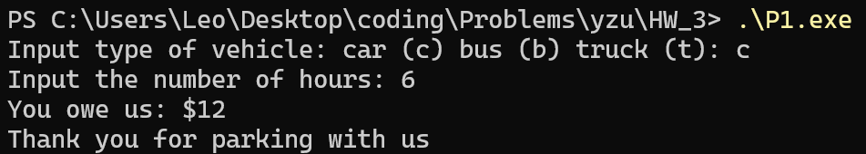
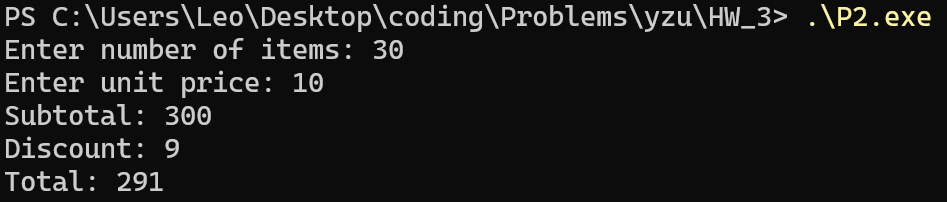
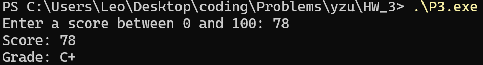
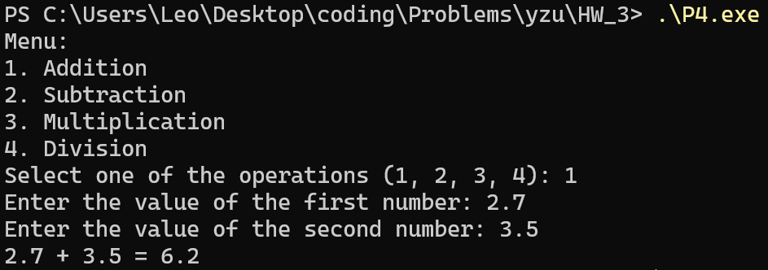

# P1
```cpp
#include <bits/stdc++.h>
using namespace std;

int main() {
    char type;
    int n;
    cout << "Input type of vehicle: car (c) bus (b) truck (t): ";
    cin >> type;
    cout << "Input the number of hours: ";
    cin >> n;

    int rate;
    switch (type) {
        case 'c':
            rate = 2;
            break;
        case 'b':
            rate = 3;
            break;
        case 't':
            rate = 4;
            break;
        default:
            cout << "Invalid vehicle type!\n";
            return 1;
    }
    cout << "You owe us: $" << rate * n << "\n";
    cout << "Thank you for parking with us\n";
    return 0;
}
```


<br><br><br><br><br><br>

# P2
```cpp
#include <bits/stdc++.h>
using namespace std;

int main() {
    int n, price;
    cout << "Enter number of items: ";
    cin >> n;
    cout << "Enter unit price: ";
    cin >> price;

    int subtotal = n * price;
    cout << "Subtotal: " << subtotal << "\n";

    double rate;
    if (n < 10) rate = 1.0;
    else if (n < 50) rate = 0.97;
    else if (n < 100) rate = 0.95;
    else rate = 0.90;

    double total = subtotal * rate;
    double discount = subtotal - total;

    cout << "Discount: " << discount << "\n";
    cout << "Total: " << total << "\n";

    return 0;
}
```


<br><br><br><br><br><br><br><br>

# P3
```cpp
#include <bits/stdc++.h>
using namespace std;

int main(){
    int score;
    string grade;
    cout << "Enter a score between 0 and 100: ";
    cin >> score;
    switch (score / 10){
        case 10:
            grade = "A+";
            break;
        case 9:
            grade = "A";
            break;
        case 8:
            grade = "B";
            break;
        case 7:
            grade = "C";
            break;
        case 6:
            grade = "D";
            break;
        default:
            grade = "F";
    }
    if (grade != "F" && score != 100){
        if (score % 10 <= 3) grade += "-";
        if (score % 10 >= 8) grade += "+";
    }
    cout << "Score: " << score << endl;
    cout << "Grade: " << grade << endl;
    return 0;
}
```


<br><br><br><br>

# P4
```cpp
#include <bits/stdc++.h>
using namespace std;

int main(){
    int oper;
    double num1, num2;
    cout << "Menu: " << endl;
    cout << "1. Addition" << endl;
    cout << "2. Subtraction" << endl;
    cout << "3. Multiplication" << endl;
    cout << "4. Division" << endl;
    cout << "Select one of the operations (1, 2, 3, 4): ";
    cin >> oper;
    if (oper < 1 || oper > 4){
        cout << "Wrong operation! The program terminates.";
        return 0;
    }
    cout << "Enter the value of the first number: ";
    cin >> num1;
    cout << "Enter the value of the second number: ";
    cin >> num2;
    if (oper == 4 && num2 == 0){
        cout << "Error division by zero. The program terminates.";
        return 0;
    }
    switch (oper){
        case 1:
            cout << num1 << " + " << num2 << " = " << num1 + num2;
            break;
        case 2:
            cout << num1 << " - " << num2 << " = " << num1 - num2;
            break;
        case 3:
            cout << num1 << " * " << num2 << " = " << num1 * num2;
            break;
        case 4:
            cout << num1 << " / " << num2 << " = " << num1 / num2;
            break;
    }
    return 0;
}
```
