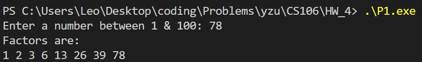
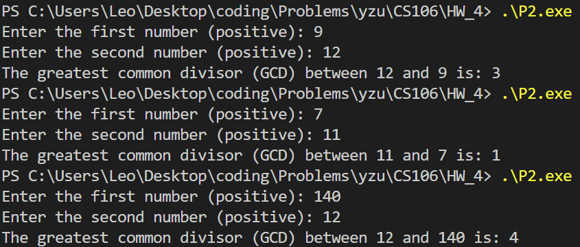
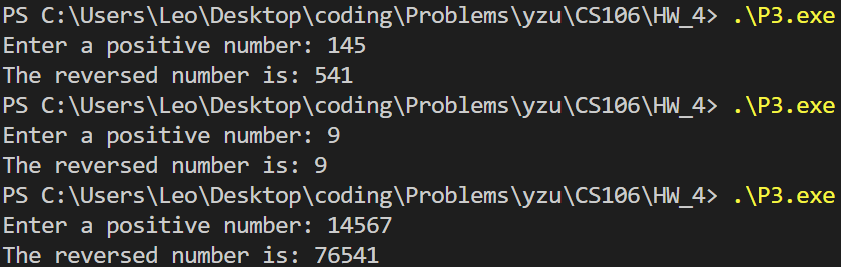
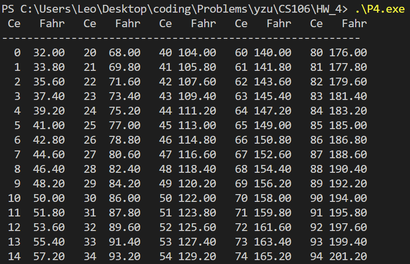

# P1
```cpp
#include <bits/stdc++.h>
using namespace std;

int main() {
    cout << "Enter a number between 1 & 100: ";
    int n;
    cin >> n;

    cout << "Factors are: " << "\n";
    for(int i=1; i<=n; i++){
        if (n%i == 0) cout << i << " ";
    }
    return 0;
}
```


<br><br><br><br><br><br><br><br><br><br><br><br><br><br><br><br><br><br><br><br>

# P2
```cpp
#include <bits/stdc++.h>
using namespace std;

int main() {
    int m, n;
    cout << "Enter the first number (positive): ";
    cin >> m;
    cout << "Enter the second number (positive): ";
    cin >> n;


    int m1 = m, n1 = n;
    while(n1>0){
        m1 %= n1;
        if (m1 < n1) swap(m1, n1);
    }

    cout << "The greatest common divisor (GCD) between " << n << " and " << m << " is: " << m1;
    return 0;
}
```


<br><br><br><br><br><br><br><br>

# P3
```cpp
#include <bits/stdc++.h>
using namespace std;

int main() {
    cout << "Enter a positive number: ";
    int n;
    cin >> n;
    
    cout << "The reversed number is: ";
    while (n>0){
        cout << n%10;
        n /= 10;
    }

    return 0;
}
```


<br><br><br><br><br><br><br><br><br><br><br><br><br><br>

# P4
```cpp
#include <bits/stdc++.h>
using namespace std;

int main() {
    cout << " Ce   Fahr   Ce   Fahr   Ce   Fahr   Ce   Fahr   Ce   Fahr\n";
    cout << "---------------------------------------------------------\n";

    cout << fixed << setprecision(2);

    for (int i = 0; i < 20; ++i) {
        for (int col = 0; col < 5; ++col) {
            int celsius = i + col * 20;
            double fahrenheit = celsius * 180.0 / 100.0 + 32.0;

            cout << setw(3) << celsius << " " 
                 << setw(6) << fahrenheit;

            if (col < 4) {
                cout << "  ";
            } else {
                cout << "\n";
            }
        }
    }

    return 0;
}
```
