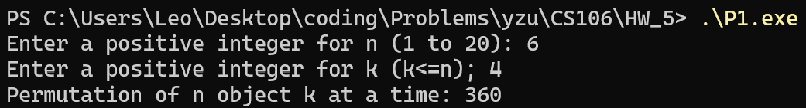
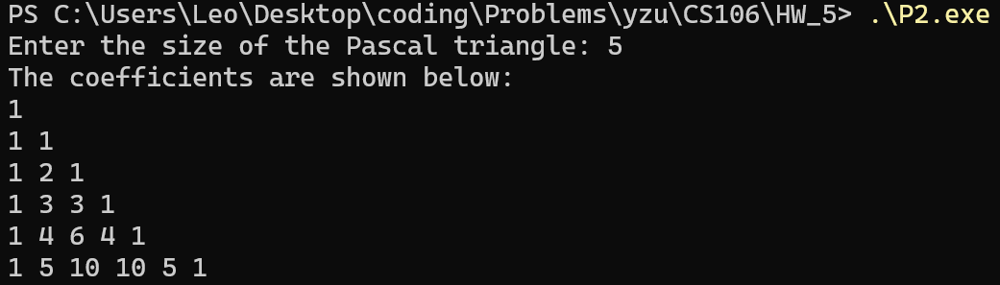
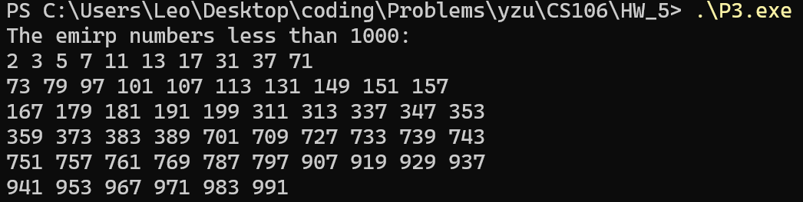
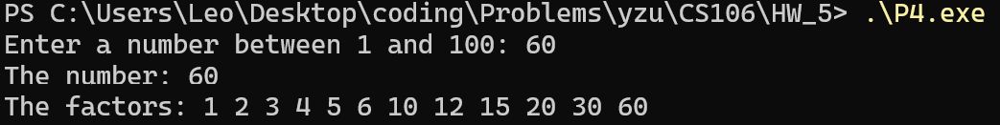

# P1
```cpp
#include <bits/stdc++.h>
using namespace std;

long long factorial(int n) {
    long long res = 1;
    for (int i = 1; i <= n; i++) {
        res *= i;
    }
    return res;
}

int main() {
    int n, k;
    cout << "Enter a positive integer for n (1 to 20): ";
    cin >> n;
    cout << "Enter a positive integer for k (k<=n); ";
    cin >> k;

    long long p = factorial(n) / factorial(n - k);
    cout << "Permutation of n object k at a time: " << p << endl;

    return 0;
}
```


<br><br><br><br><br><br><br><br><br><br><br><br><br>

# P2
```cpp
#include <bits/stdc++.h>
using namespace std;

int pascal(int row, int col) {
    if (col == 0 || col == row) {
        return 1;
    }
    return pascal(row - 1, col - 1) + pascal(row - 1, col);
}

int main() {
    int n;
    cout << "Enter the size of the Pascal triangle: ";
    cin >> n;
    cout << "The coefficients are shown below:" << endl;

    for (int i = 0; i <= n; i++) {
        for (int j = 0; j <= i; j++) {
            cout << pascal(i, j) << " ";
        }
        cout << endl;
    }

    return 0;
}
```


<br><br><br><br><br><br><br><br>

# P3
```cpp
#include <bits/stdc++.h>
using namespace std;

bool isPrime(int n) {
    if (n < 2) return false;
    for (int i = 2; i * i <= n; i++) {
        if (n % i == 0) return false;
    }
    return true;
}

int reverseNum(int n) {
    int rev = 0;
    while (n > 0) {
        rev = rev * 10 + n % 10;
        n /= 10;
    }
    return rev;
}

bool isEmirp(int n) {
    return isPrime(n) && isPrime(reverseNum(n));
}

void printEmirp() {
    cout << "The emirp numbers less than 1000:" << endl;
    int count = 0;
    for (int i = 2; i < 1000; i++) {
        if (isEmirp(i)) {
            cout << i << " ";
            count++;
            if (count % 10 == 0) {
                cout << endl;
            }
        }
    }
    if (count % 10 != 0) {
        cout << endl;
    }
}

int main() {
    printEmirp();
    return 0;
}
```


<br><br><br><br><br><br><br><br><br><br><br><br><br><br>
<br><br><br><br><br><br><br><br><br><br><br><br><br><br>
<br><br><br><br><br><br>

# P4
```cpp
#include <bits/stdc++.h>
using namespace std;

bool isDivisible(int num, int divisor) {
    return num % divisor == 0;
}

int main() {
    int n;
    cout << "Enter a number between 1 and 100: ";
    cin >> n;

    cout << "The number: " << n << endl;
    cout << "The factors: ";
    for (int i = 1; i <= n; i++) {
        if (isDivisible(n, i)) {
            cout << i << " ";
        }
    }
    cout << endl;

    return 0;
}
```
